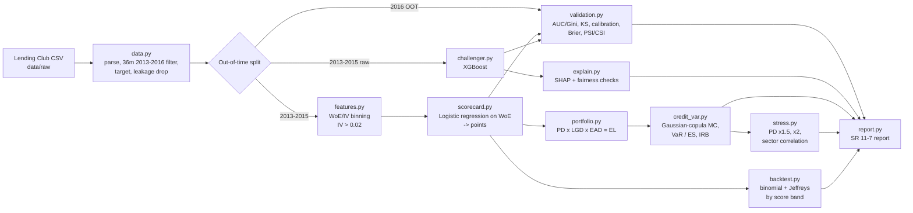

# Credit Default Risk Modelling & Portfolio Credit VaR

**Python, scikit-learn, XGBoost, SHAP, optbinning**

An end-to-end retail credit risk workflow on the public Lending Club accepted-loans data:

1. **PD model**: a probability-of-default model for 36-month loans issued 2013-2016,
   with WoE/IV-binned features feeding an interpretable **logistic-regression scorecard**
   (PDO 20, 600 points at 50:1 odds), benchmarked against an **XGBoost challenger**.
2. **Validation**: out-of-time testing (train 2013-2015, test 2016) with AUC/Gini, KS,
   calibration and Brier score; PSI/CSI drift monitoring; a paired-bootstrap test of the
   challenger's Gini lift; and **SHAP** global and local attributions with a responsible-AI review.
3. **Portfolio risk**: empirical LGD from recoveries, EAD = outstanding principal,
   **Expected Loss** by grade and sector, **99.9% credit VaR and Expected Shortfall** from a
   100K-path one-factor Gaussian-copula Monte Carlo with a sector factor, a comparison with the
   Basel IRB closed-form capital formula, stress tests, and **back-testing** by score band.
4. An **SR 11-7 style model validation report** generated automatically from each run.

> **Results.** This README holds no performance numbers on purpose. Every metric is computed
> at run time and written to `reports/model_validation_report.md` and `reports/metrics.json`.
> Until the pipeline has been run on the real data, the committed report is a template whose
> values all read `<<RUNTIME: ...>>`.

| Result | Value |
|---|---|
| OOT Gini: scorecard / XGBoost | `<<filled at runtime>>` |
| Challenger Gini lift (95% CI) | `<<filled at runtime>>` |
| Score PSI, train vs OOT | `<<filled at runtime>>` |
| 1-year EL / 99.9% VaR / ES | `<<filled at runtime>>` |

## Architecture



## Setup

```bash
python -m venv .venv && source .venv/bin/activate   # Windows: .venv\Scripts\activate
pip install -r requirements.txt
pip install -e .
```

**Data.** Download `accepted_2007_to_2018Q4.csv` (about 1.6 GB) from the Kaggle dataset
*"Lending Club Loan Data"* (wordsforthewise/lending-club) and save it as
`data/raw/accepted_2007_to_2018Q4.csv`. The file is git-ignored.

## How to run

```bash
# Full pipeline on the real data (100,000 Monte Carlo paths by default)
python -m credit_risk_pd.pipeline --data data/raw/accepted_2007_to_2018Q4.csv

# Quick development run on the first 500K rows of the CSV, with fewer paths
python -m credit_risk_pd.pipeline --data data/raw/accepted_2007_to_2018Q4.csv --nrows 500000 --n-paths 20000

# Smoke test without the real data, using the synthetic Lending-Club-shaped generator
python -m credit_risk_pd.pipeline --synthetic 20000 --output-dir reports/synthetic_smoke

# Tests
pytest -q
```

Outputs (under `--output-dir`, default `reports/`):

- `model_validation_report.md`: the SR 11-7 style report
- `metrics.json`: headline metrics
- `tables/*.csv`: IV table, points table, calibration, SHAP, EL, stress and back-test tables
- `figures/*.png`: ROC, calibration, score distribution, loss distribution, SHAP importance

Settings such as years, binning, scorecard scaling, XGBoost parameters, correlations and
stress scenarios live in `configs/config.yaml`.

## Project structure

```
credit-risk-pd/
├── configs/config.yaml          # all run parameters
├── data/raw/                    # Lending Club CSV goes here (git-ignored)
├── notebooks/01_eda.ipynb       # exploratory analysis skeleton
├── reports/
│   └── model_validation_report.md   # template; overwritten with real results by the pipeline
├── src/credit_risk_pd/
│   ├── data.py          # load, parse, population filter, target, leakage control, OOT split
│   ├── features.py      # WoE/IV binning (optbinning, with a quantile fallback)
│   ├── scorecard.py     # logistic-regression scorecard + points scaling + reason codes
│   ├── challenger.py    # XGBoost challenger
│   ├── validation.py    # AUC/Gini, KS, Brier, calibration, PSI/CSI, bootstrap Gini lift
│   ├── explain.py       # SHAP global/local, fairness checks, responsible-AI note
│   ├── portfolio.py     # LGD, EAD, Expected Loss by grade / sector
│   ├── credit_var.py    # Gaussian-copula Monte Carlo, VaR/ES, Vasicek and Basel IRB
│   ├── stress.py        # PD multipliers and sector-correlation stress
│   ├── backtest.py      # binomial and Jeffreys tests by score band
│   ├── report.py        # Markdown report template, rendering and figures
│   ├── synthetic.py     # synthetic Lending-Club-shaped data for smoke tests
│   └── pipeline.py      # CLI entry point
├── tests/               # pytest: metrics, binning, scorecard, credit VaR, back-test, smoke run
├── requirements.txt
├── pyproject.toml
└── LICENSE
```

## Methodology

### Data and target
- **Population:** 36-month loans issued 2013-2016. Restricting to one term keeps the PD
  horizon consistent.
- **Target:** `default = 1` for *Charged Off* or *Default* and `0` for *Fully Paid*. Loans that
  are still *Current* or *Late* at the data cut-off have no outcome yet and are excluded
  (see Limitations in the report).
- **Leakage control:** features come from an explicit allowlist of application-time fields.
  Post-origination fields (payments, recoveries, `last_fico_*`, hardship and settlement flags)
  are dropped. Recoveries and principal repaid are kept under an `outcome_` prefix for LGD
  estimation only, and a guard function fails the run if one of them enters a feature list.
- **Split:** out-of-time. The model is trained on 2013-2015 and tested on 2016, which tests
  robustness to a shift in vintage. The XGBoost early-stopping set comes from the training
  window only.

### WoE / IV binning
`optbinning.OptimalBinning` bins each feature (at most 8 bins, each holding at least 5% of
loans, with monotone event rates for numeric features). The pipeline prints the IV table and
keeps features with IV > 0.02. IV above 0.5 is flagged as possible leakage.
Convention: WoE = ln(%good / %bad).

### Scorecard (champion)
- **Model:** logistic regression on the WoE features.
- **Feature selection:** of any WoE pair with |corr| > 0.7, the feature with lower IV is
  dropped. A feature is also dropped when its coefficient's sign contradicts its univariate
  relationship with default.
- **Scaling:** `score = offset + factor * ln(odds)`, where `factor = 20 / ln 2` and
  `offset = 600 - factor * ln 50`.
- **Points:** attribute points add up exactly to the score, and reason codes are the
  features where an applicant lost the most points.

### Challenger
XGBoost runs on the raw features with one-hot categoricals, native missing-value handling,
shallow trees and early stopping. It uses no class re-weighting, so its PDs stay calibrated.

### Validation
- **Discrimination:** AUC, Gini and KS.
- **Calibration:** Brier score and predicted vs observed default rate by decile.
- **Stability:** PSI on scores and CSI on binned features.
- **Challenger comparison:** a paired bootstrap confidence interval for the Gini lift.
- **Monitoring triggers:** PSI > 0.25, or a Gini drop of more than 5 points from development.

### Explainability and responsible AI
- **SHAP:** TreeSHAP values for the challenger, with one-hot columns summed back to the
  original feature. The output includes global mean |SHAP| and local explanations for the
  highest-, median- and lowest-PD applicants.
- **Fairness checks:** calibration, AUC, approval rate and the four-fifths adverse-impact
  ratio, by home ownership and by census region. Region is derived from `addr_state`, which
  is deliberately excluded from the model.
- **Exclusions:** the report documents excluded fields and why: geographic proxies,
  free text, and redundant or leaky fields.

### Portfolio credit risk
- **LGD:** `1 - recoveries / (funded_amnt - principal repaid)` for each defaulted loan in
  the training window, clipped to [0, 1] and averaged by grade.
- **EAD:** outstanding principal, either at origination or as the average scheduled balance
  over 12 months.
- **PD:** the champion's lifetime PD, converted to a 1-year PD assuming a constant hazard.
  EL = PD x LGD x EAD, aggregated by grade and by purpose (the "sector").
- **Credit VaR:** each obligor's asset return is
  `A_i = sqrt(rho) Z + sqrt(rho_s) Z_sector + sqrt(1 - rho - rho_s) eps_i`, with rho = 0.15
  and a sector loading of 0.05. A loan defaults when `A_i < Phi^-1(PD_i)`. Loans are grouped
  into sector x PD-band cells. On each of 100,000 vectorised paths, the default count in each
  cell is drawn as Binomial(n, conditional PD), which keeps granularity risk. The engine
  reports EL, 99.9% VaR, ES and unexpected loss.
- **Benchmarks:** the Vasicek ASRF closed form at the same rho, and the Basel IRB
  other-retail formula (correlation 3%-16%, 99.9%).
- **Stress tests:** PD x1.5, PD x2, and a raised correlation within the debt-consolidation
  sector. All scenarios use the same random seed, so the differences come from the shocks
  rather than Monte Carlo noise.
- **Back-testing:** score bands are fixed on the development sample. On the OOT sample, each
  band gets a one-sided binomial test and a Jeffreys test (ECB/EBA style), with a traffic-light
  result.

## License

MIT © Mayank Sharma
